Blume renders standard Markdown and MDX with a curated, GitHub-flavored feature set — no imports, no configuration. Write content the way you already do; this page shows everything that's supported, with a live preview and the source for each.

## Headings

Structure a page with headings. Blume renders your frontmatter `title` as the page heading, so start your content at `##` — `##` and `###` become entries in the table of contents. A page without a `title` takes its first `#` heading as its title, and when the page opens with that heading, it shows once, as the page heading, which keeps the heading's anchor so links to it still land. `llms-full.txt` lists it once too. Every `##`–`######` heading is also wrapped in a link to its own anchor, so readers can click a heading to copy, bookmark, or share a permalink straight to that section (hover to reveal the `#`). Turn this off with `markdown: { headingAnchors: false }` in `blume.config.ts`.

```md
## Section

### Subsection

#### Detail
```

### Custom anchors

Anchor ids are generated from the heading text, so a reworded heading gets a new anchor. A `<Badge>` in a heading is a label, not part of that text: `## Install <Badge>beta</Badge>` anchors as `#install` and reads "Install" in the table of contents. An id never ends in a dash, so `## Features ✨` anchors as `#features`, and a component or image at either end of a heading adds no dash. Append `[#custom-id]` to pin the anchor instead — the marker never renders, and links keep working no matter how the heading reads. Pinned anchors also stay identical across [translated locales](/docs/content/i18n), where auto-generated ids would otherwise differ per language.

```md
## Getting started [#setup]
```

Link to it as `/page#setup`. The syntax matches Fumadocs, so migrated content works verbatim. The id is used exactly as written: smart punctuation turns `--` into a dash and curls quotes in the heading's text, but not in the marker, so `[#read--write]` anchors as `#read--write`.

The `{#custom-id}` form used by Pandoc, kramdown, and Markdown-based specification toolchains is accepted as an equivalent in `.md` files. Only that unspaced spelling pins an anchor: the spaced `{ #custom-id }` and kramdown's `{: #custom-id }` (both from MkDocs' `attr_list`), and an attribute list that sets the id beside classes or attributes (`{ #custom-id .wide }`), stay in the heading's text and its anchor, and `blume check` warns about them in `.md` as `BLUME_MD_CURLY_ANCHOR`. In `.mdx`, a bare `{…}` is a JSX expression and the page fails to compile — `blume check` reports all three spellings as `BLUME_MDX_CURLY_ANCHOR` — so write `[#custom-id]` there, or escape the braces. The escaped form pins the same anchor in both formats, which makes it the right spelling for a partial that `.mdx` pages [include](/docs/content/includes):

```md
## Getting started \{#setup\}
```

Fragment links can also target a raw HTML element with an `id` (`<a id="setup"></a>`), or an `<a name="setup">`; `blume validate` accepts those alongside heading anchors.

An empty `<a>` inside a heading is the heading's own anchor, the way GitBook exports (`<a href="#setup" id="setup"></a>`) and wikis (`<a name="setup"></a>`) write one. Blume takes it out of the heading and gives the heading its `id`, or else its `name`, so `#setup` links keep landing there and the heading keeps its own self-link. A `[#custom-id]` marker on the same heading wins.

```md
## Getting started <a id="setup"></a>
```

### Table of contents markers

Two more trailing markers control how a heading appears in the table of contents. `[!toc]` keeps a heading on the page but out of the TOC; `[toc]` does the reverse — the heading shows only in the TOC, as an invisible anchor target, which is useful for labeling sections built from components rather than prose. Markers chain in any order. One exception, inherited from CommonMark: a trailing bracket whose label has a link-reference definition anywhere on the page (`[toc]: /url`) is a shortcut reference link, not a marker, and stays in the heading text.

```md
## Appears on the page only [!toc]

## Appears in the TOC only [toc]

## Both markers together [toc] [#custom-id]
```

Markers are always parsed — a heading that literally ends in marker-shaped text would be treated as marked. Backslash-escaping doesn't help (Markdown resolves `\[` to `[` before the marker parse runs); to show literal marker text at the end of a heading, wrap it in inline code: `` ## Using `[toc]` ``.

## Emphasis

Inline formatting for stressing words, marking deletions, and showing code or keystrokes mid-sentence.

**Bold**, _italic_, ~~strikethrough~~, and `inline code`.

```md
**Bold**, _italic_, ~~strikethrough~~, and `inline code`.
```

## Keyboard keys

For shortcuts and keystrokes. A `<kbd>` element renders as the same bordered key badge the search dialog uses, in Markdown, MDX, and inside components like `<Steps>` and `<Callout>`.

Press <kbd>⌘</kbd> <kbd>K</kbd> to open search, or <kbd>Esc</kbd> to close it.

```md
Press <kbd>⌘</kbd> <kbd>K</kbd> to open search, or <kbd>Esc</kbd> to close it.
```

## Superscript and subscript

For footnote markers, ordinals, and scientific or chemical notation inline.

E = mc^2^ and H~2~O.

{/* prettier-ignore */}
```md
E = mc^2^ and H~2~O.
```

## Blockquotes

Set off a quotation, callout aside, or an editorial note from the surrounding text.

> Documentation that's fast, AI-ready, and zero-config — down to the template.

```md
> Documentation that's fast, AI-ready, and zero-config — down to the template.
```

## Lists

Use unordered lists for unordered sets, ordered lists for sequences, and task lists for checklists and roadmaps.

- Markdown-first authoring
- Static by default
  - Opt into server features
- Own your output

1. Install Blume
2. Write a page
3. Ship it

- [x] Scaffold the project
- [ ] Write the first guide

```md
- Markdown-first authoring
- Static by default
  - Opt into server features
- Own your output

1. Install Blume
2. Write a page
3. Ship it

- [x] Scaffold the project
- [ ] Write the first guide
```

## Tables

Tabulate structured data — config options, comparison matrices, parameter lists. Use colons in the divider row to align columns.

| Command       | Description           | Output  |
| ------------- | --------------------- | :-----: |
| `blume dev`   | Start the dev server  |    —    |
| `blume build` | Build the static site | `dist/` |

```md
| Command       | Description           | Output  |
| ------------- | --------------------- | :-----: |
| `blume dev`   | Start the dev server  |    —    |
| `blume build` | Build the static site | `dist/` |
```

For a table without a header row — key–value pairs, for example — leave the header cells empty. Markdown requires the header and divider rows syntactically, but Blume drops the empty header from the rendered table.

```md
|                |          |
| -------------- | -------- |
| Current status | E-3 visa |
```

## Links and images

Link to other pages or external sites. Images accept a relative path to a file next to your content, any path under `public/` (served at the site root), or a remote URL.

A relative page link (`./install`, `../guides/setup`) resolves from the page's own folder — on an index page, the folder it introduces — and a link to a Markdown file (`./setup.md`, `../intro.mdx`) lands on the page that file publishes, its `slug` included. A dotted page name (`./node.js` for a `node.js.mdx` page) counts as a page link when a page publishes there, and a component's string `href` (`<Card href="./install">`) resolves the same way. Blume writes each one as the root-relative route in the built page, so links authored for GitHub or Docusaurus keep working, and [`blume validate`](/docs/cli/validate) checks them the same way.

A root-relative link to a Markdown file (`/guides/setup.md`, the way VitePress and Docsify write one) lands on that file's page too, read from your content root; under a [deployment `base`](/docs/deployment#subpath-deploys), one that starts with the base is read as including it. One that names no file in your content keeps its path, since `/guides/setup.md` is also the URL of that page's [Markdown copy](/docs/discoverability/markdown#raw-markdown). To link a page's Markdown copy whatever its file is called, write a raw `<a href="/guides/setup.md">`, which keeps its path, or the copy's full URL.

A link to a Markdown file that doesn't exist tries the same file with the other extension first. So after you rename `setup.md` to `setup.mdx`, a link to `./setup.md` still lands on that file's page, its `slug` and ordering prefix included, and `blume validate` passes it. A link that names neither file falls back to a plain relative link with the extension dropped. Either way, the link no longer names a real file, so it breaks wherever the Markdown is read as files, such as on GitHub. Update the extension in your links when you rename a file.

Read the [quickstart](/docs/quickstart) to get started.

```md
Read the [quickstart](/docs/quickstart) to get started.


```

External links open in the same tab by default. Set `markdown: { externalLinks: true }` in `blume.config.ts` to open them in a new tab, the way Blume's header and sidebar links already do: every absolute `https://` or `//host` link gets `target="_blank"` and `rel="noreferrer"`, a small arrow after its text, and a screen-reader note that it opens in a new tab. Links to your own pages, `#fragments`, and `mailto:`/`tel:` links stay in the tab, and so does a raw `<a>` tag, which keeps the attributes you wrote.

**Prefer relative paths for local images** — they're optimized at build time: compressed, converted to WebP, and stamped with intrinsic `width`/`height` so the page doesn't shift while loading. Keep the image next to the page that uses it (or in a shared folder inside your content directory) and reference it relatively:

```md

```

An SVG whose size Astro can't read is served as it is instead of failing the build. Astro reads an SVG's size from its `<svg>` tag, which needs a width and height or a viewBox and has to end within the file's first 1,000 bytes; a draw.io export puts its whole diagram in a `content` attribute on that tag, which pushes it past them. Blume warns about each one as `BLUME_SVG_UNOPTIMIZED` at the line that embeds it. The image still shows, without the intrinsic size an optimized image carries; export the diagram without the copy of its source, or remove the `content` attribute, to have it optimized.

A link to a file next to your content that isn't a page (`[the spec](./spec.pdf)`, `[data](../files/data.csv)`, or a reference definition like `[spec]: ./spec.pdf`) publishes that file with the page, and the built link points at the published copy, keeping a suffix like `#page=2`. So does an HTML element that names one: the `src` of an ``, `<video>`, `<source>`, or `<audio>`, and the `href` of an `<a>` or of a component like `<Card>`, as raw HTML in `.md` or an element in `.mdx`. These copies are served as they are, without the optimization an image embed gets. A relative link that names no file next to the page keeps its path, so one to a file under `public/` still works.

Absolute paths under `public/` (``) are served verbatim with no optimization — use them for files that must keep their exact bytes and URL, like a logo referenced from outside your docs. Remote images are also passed through untouched unless their host is authorized in the [`image` config](/docs/configuration#images).

Content images are click-to-zoom by default — readers can click any image to open it in a lightbox. Turn this off with `markdown: { imageZoom: false }` in `blume.config.ts`, or opt a single image out with `data-no-zoom`.

## Horizontal rule

Separate major shifts in topic within a long page.

---

```md
---
```

## Code blocks

Fenced code blocks are syntax-highlighted with a header showing the language — with a brand icon for recognized languages — and a copy button. Add a **title** after the language — typically a filename — and it replaces the language label in the header.

```ts blume.config.ts
import { defineConfig } from "blume";

export default defineConfig({
  title: "My docs",
});
```

````md
```ts blume.config.ts
import { defineConfig } from "blume";

export default defineConfig({
  title: "My docs",
});
```
````

The title is every word after the language, so ` ```js Install the client ` titles the block "Install the client". Keywords like `lineNumbers` and `wrap`, line ranges like `{1,4-5}`, and `key="value"` options aren't part of it, and `title="..."` sets the title explicitly. A title in brackets, like ` ```ts [blume.config.ts] `, shows without them, and a line range written against the brackets, as in ` ```ts [blume.config.ts]{2} `, still highlights its lines.

The language is any [Shiki language](https://shiki.style/languages) id or alias, in any case: ` ```JSON ` highlights like ` ```json `. A block in a language Shiki doesn't know renders as plain text, and Blume warns about its fence as `BLUME_UNKNOWN_CODE_LANGUAGE`; write `text` for a block that's plain on purpose.

Options other docs tools read do nothing here, and Blume warns about each as `BLUME_CODE_FENCE_OPTION` with the spelling to use instead: MkDocs' `hl_lines="2 3"` (a `{2,3}` range here) and `linenums="1"` (`lineNumbers`), `showLineNumbers` (`lineNumbers`), Mintlify's `lines` (`lineNumbers`), Fern's `wordWrap` (`wrap`), and `filename="app.js"` (`title="app.js"`). On a Rust block, rustdoc's and mdBook's `ignore`, `no_run`, `should_panic`, `compile_fail`, `edition2015` through `edition2024`, `noplayground`, and `editable` warn too: Blume never compiles, tests, or runs a code block, so remove them. None of them becomes part of the title.

A `console` (or `shellsession`) block is a terminal session: commands after a prompt like `$`, with their output. Its copy button copies only the commands, without their prompts, so the copy pastes straight into a terminal. A command that ends in `\` keeps its continuation lines.

```console
$ npm install blume
added 1 package in 2s
$ npx blume dev
```

Inline code can be highlighted too: add a `{:lang}` marker inside a backtick span and it's colored like a tiny code block — `useState(){:js}` or `T extends object{:ts}`. It only kicks in when you add the marker, so plain inline code stays untouched — nothing to switch on.

Highlighting uses the `github-light`/`github-dark` themes by default. Swap in any [bundled Shiki theme](https://shiki.style/themes) per color mode with `markdown.code.theme` — it colors every code surface at once (fences, inline snippets, `<CodeBlock>`, and `<Diff>`):

```ts blume.config.ts
export default defineConfig({
  markdown: {
    code: {
      theme: { light: "github-light", dark: "vesper" },
    },
  },
});
```

You can also provide a custom [Shiki theme definition](https://shiki.style/guide/load-theme) directly. Import a VS Code-compatible theme JSON file (using an import attribute when your runtime requires one) and assign it to either color mode; bundled names and custom definitions can be mixed:

```ts blume.config.ts
import darkTheme from "./themes/acme-dark.json" with { type: "json" };

export default defineConfig({
  markdown: {
    code: {
      theme: { light: "github-light", dark: darkTheme },
    },
  },
});
```

### Line numbers

Append `lineNumbers` to render a line-number gutter — on its own or alongside a title:

```ts server.ts lineNumbers
import { createServer } from "node:http";

createServer().listen(3000);
```

````md
```ts server.ts lineNumbers
import { createServer } from "node:http";

createServer().listen(3000);
```
````

### Long lines and long blocks

Append `wrap` to wrap one block's long lines instead of scrolling them sideways:

```ts client.ts wrap
const client = createClient({
  baseUrl: "https://api.example.com/v1",
  retries: 3,
  timeout: 10_000,
  headers: { "x-client": "docs" },
});
```

````md
```ts client.ts wrap
const client = createClient({
  baseUrl: "https://api.example.com/v1",
  retries: 3,
  timeout: 10_000,
  headers: { "x-client": "docs" },
});
```
````

Append `expandable` to a long block to show its first lines with a **Show more** toggle under them. Opened, the block shows in full, with no scrolling inside it. A block under 16 lines renders as usual, since there's little to hide.

```ts routes.ts expandable
import { defineRoutes } from "./router";

export default defineRoutes({
  home: "/",
  docs: "/docs",
  guides: "/docs/guides",
  reference: "/docs/reference",
  changelog: "/changelog",
  blog: "/blog",
  pricing: "/pricing",
  about: "/about",
  careers: "/careers",
  contact: "/contact",
  privacy: "/legal/privacy",
  terms: "/legal/terms",
  security: "/security",
  status: "https://status.example.com",
});
```

````md
```ts routes.ts expandable
import { defineRoutes } from "./router";

export default defineRoutes({
  // …every route
});
```
````

Both work alongside a title and `lineNumbers`. To wrap every block, set `markdown.code.wrap` instead.

### Highlighting

Annotate code with GitHub-style comments to draw attention to lines, words, and changes. The comments are stripped from the rendered output, so the code stays copy-paste clean. All of them are on by default — no configuration.

Mark a line with `// [!code highlight]` to give it a highlighted background:

```ts
const config = defineConfig({
  title: "My docs", // [!code highlight]
});
```

Show changes with `// [!code ++]` for additions and `// [!code --]` for removals, rendered as a green/red diff:

```ts
export default defineConfig({
  title: "My docs", // [!code --]
  title: "Blume docs", // [!code ++]
});
```

Highlight every occurrence of a term on a line with `// [!code word:createServer]`:

```ts
import { createServer } from "node:http"; // [!code word:createServer]

createServer().listen(3000);
```

Flag a line as a problem with `// [!code error]` or `// [!code warning]`, tinted red and amber:

```ts
const port = process.env.PORT; // [!code warning]
server.listen(port.trim()); // [!code error]
```

Dim everything except the lines you mark with `// [!code focus]` (the rest sharpens on hover):

```ts
export default defineConfig({
  title: "My docs", // [!code focus]
  description: "Built with Blume",
});
```

Or highlight lines by **number** instead of comments — useful when you can't edit the code. Put a brace range after the language, with or without a space between them (` ```ts{1,4-5} ` works too); single lines, comma lists, and `start-end` spans all work:

```ts {1,4-5}
import { defineConfig } from "blume";

export default defineConfig({
  title: "My docs",
  description: "Built with Blume",
});
```

````md
```ts {1,4-5}
import { defineConfig } from "blume";

export default defineConfig({
  title: "My docs",
  description: "Built with Blume",
});
```
````

### Display types

Mark a TypeScript block `twoslash` to display real types straight from the compiler — powered by [Twoslash](https://shiki.style/packages/twoslash). Hover any token to see its inferred type, and add an inline `^?` query to pin a type below the line.

```ts twoslash
const config = {
  title: "My docs",
  version: 1,
};

config.title;
//     ^?
```

````md
```ts twoslash
const config = { title: "My docs", version: 1 };

config.title;
//     ^?
```
````

### TypeScript and JavaScript tabs

Mark a `ts` or `tsx` block `ts2js` to render it as a tab pair: your TypeScript alongside an auto-generated JavaScript variant, so you maintain one snippet and readers pick their dialect. The conversion strips type syntax and type-only imports while keeping your formatting, comments, and JSX exactly as written — and tabs sync, so choosing JavaScript once switches every pair on the page. Like diagrams and math, this is an MDX-only feature — in a `.md` file the block renders as a plain TypeScript fence.

```ts ts2js
import { defineConfig } from "blume";

interface Author {
  name: string;
}

const author: Author = { name: "Hayden" };

export default defineConfig({
  title: `${author.name}'s docs`,
});
```

````md
```ts ts2js
import { defineConfig } from "blume";

interface Author {
  name: string;
}

const author: Author = { name: "Hayden" };

export default defineConfig({
  title: `${author.name}'s docs`,
});
```
````

Other fence meta composes: a `title="..."` shows on both tabs, while `{1,4-5}` line ranges apply only to the TypeScript tab (line numbers shift once types are gone). The one exception is `twoslash` — hover types can't carry over to generated code, so a fence marked both stays a plain Twoslash block.

:::note
Hide the language icons or wrap long lines instead of scrolling with `markdown: { code: { icons: false, wrap: true } }` in `blume.config.ts`.
:::

## Package install

A `package-install` block turns a single install command into a tabbed snippet for npm, pnpm, yarn, bun, nub, and aube — so readers copy the one that matches their setup. Like diagrams and math, this is an MDX-only feature — in a `.md` file the block renders as a plain code fence.

```package-install
npm i blume
```

````md
```package-install
npm i blume
```
````

## Diagrams

A `mermaid` block renders a [Mermaid](https://mermaid.js.org) diagram straight from text. Blume draws it with [Pele](https://pele.run), which supports every diagram type built into Mermaid 12.1.0, so the fence contents are passed through verbatim. Diagrams read the site's theme tokens, so they follow the active color theme and custom themes without redrawing. Author one by fencing the source with `mermaid`:

````md
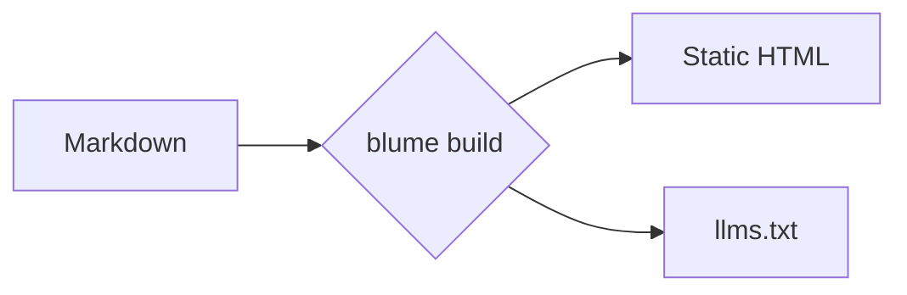
````

Diagrams render on the client, so this is an MDX-only feature, and Pele loads only on pages that include one; a site with no diagram doesn't ship it at all. Pele lays diagrams out with its own engine, so Mermaid's `layout` and `look` options and its theme colors don't apply; colors set with `style`, `classDef`, or a sequence `rect` stay fixed in both themes, while everything else follows the site tokens. A diagram reflows to the width of the content column — a wide flowchart can switch to a vertical layout — rather than always shrinking to fit, and labels use the theme font. A diagram Pele can't parse shows "Could not render this diagram." in its place; the parser error, with the line it stopped on, goes to the browser console, and `blume dev` also prints it under the message. The rest of this section is a gallery of common types — see the [Mermaid docs](https://mermaid.js.org/intro/) for the full list.

### Flowchart


### Sequence diagram

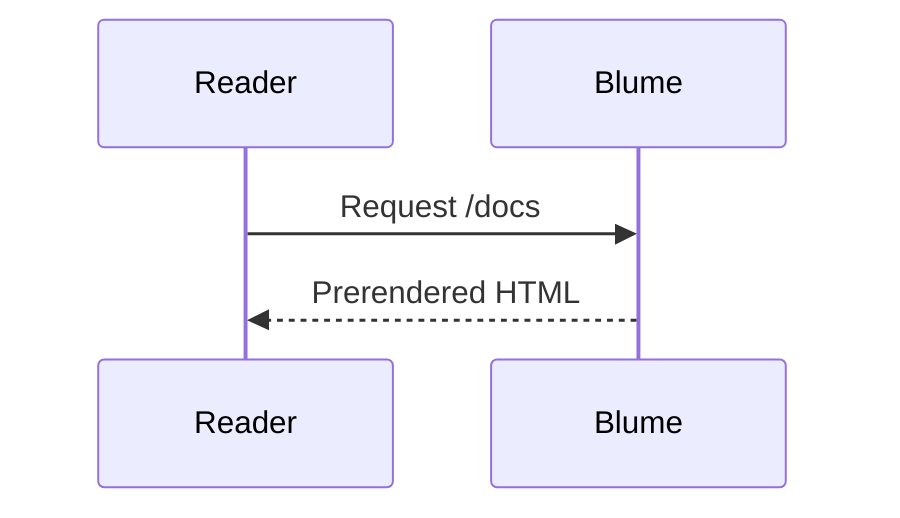

### Class diagram

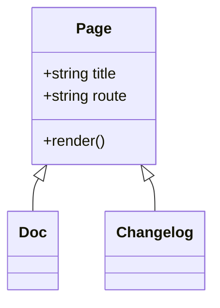

### State diagram

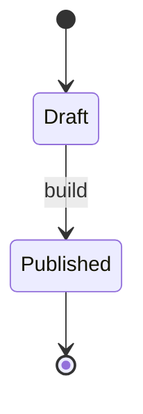

### Entity relationship

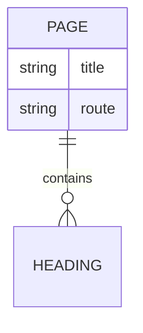

### User journey

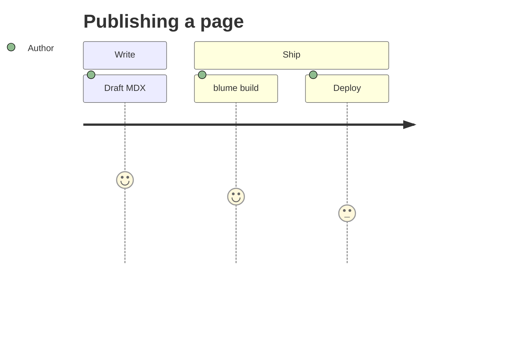

### Gantt

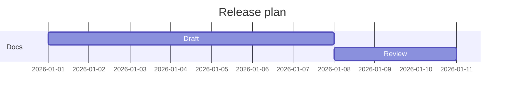

### Git graph

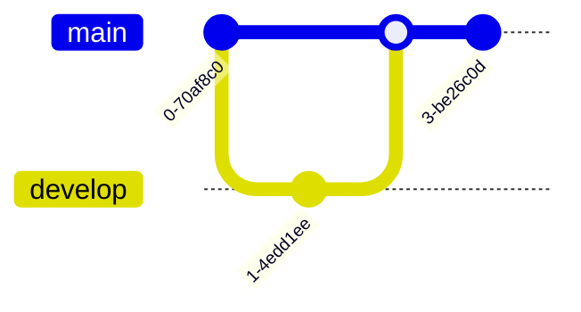

### Pie chart

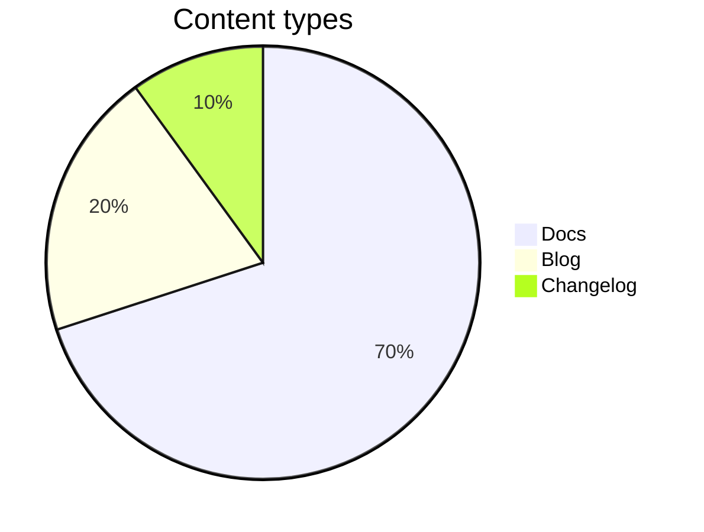

### Mindmap

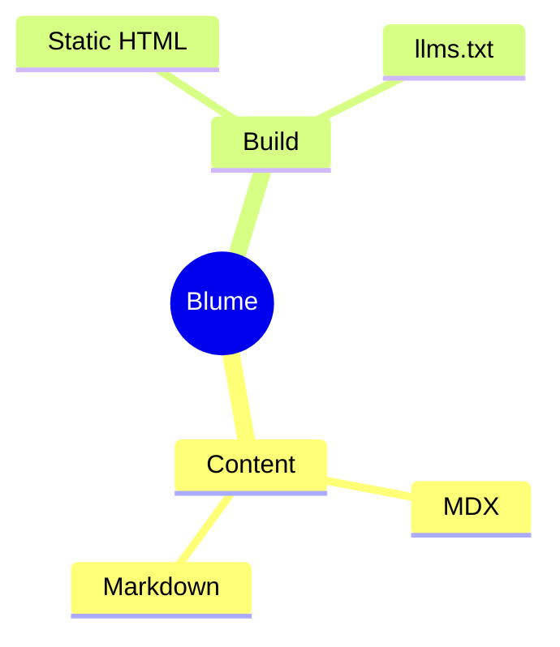

### Timeline

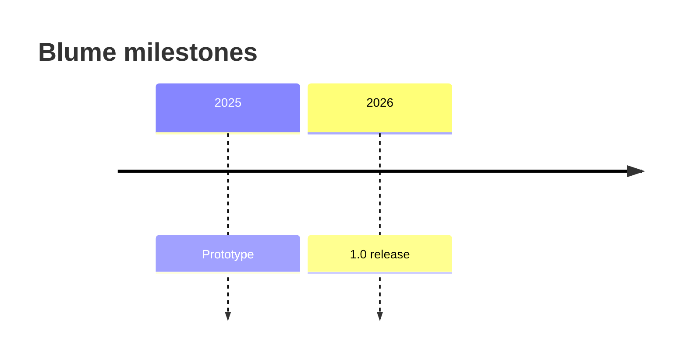

## Callouts

Callouts pull a reader's attention to context, advice, or risk. Write them as `:::type` directives; add a title in brackets, like `:::warning[Heads up]`. The title keeps its inline formatting, so code, emphasis, and links in the brackets render in the title. Directives are an MDX-only feature — in a `.md` file a `:::note` line stays literal text, and `blume dev`, `blume build`, and `blume check` warn about it as `BLUME_MD_DIRECTIVE`. Rename the page to `.mdx` to render it as a callout.

### Note

Neutral, supporting context the reader should keep in mind.

:::note
Blume regenerates `.blume/` on every run — never edit it by hand.
:::

```md
:::note
Blume regenerates `.blume/` on every run — never edit it by hand.
:::
```

### Tip

A helpful shortcut or best practice that isn't required but makes life easier.

:::tip
Set `deployment.site` so sitemaps and Open Graph images use absolute URLs.
:::

```md
:::tip
Set `deployment.site` so sitemaps and Open Graph images use absolute URLs.
:::
```

### Success

Confirm a positive outcome or that a step completed as expected.

:::success
Your docs built successfully and are ready to deploy.
:::

```md
:::success
Your docs built successfully and are ready to deploy.
:::
```

### Warning

Flag something that needs care to avoid a mistake or surprising behavior.

:::warning[Heads up]
Server output needs a host adapter from `blume/deploy` before you can deploy.
:::

```md
:::warning[Heads up]
Server output needs a host adapter from `blume/deploy` before you can deploy.
:::
```

### Danger

Call out a destructive or breaking action that can't easily be undone.

:::danger
`blume eject` is a one-way step — the generated Astro project becomes yours.
:::

```md
:::danger
`blume eject` is a one-way step — the generated Astro project becomes yours.
:::
```

### Info

An informational aside; an alias-friendly default that reads as neutral.

:::info
The core theme ships no client framework JS.
:::

```md
:::info
The core theme ships no client framework JS.
:::
```

The names `caution`, `error`, `important`, and `warn` are accepted as aliases for `warning`, `danger`, `note`, and `warning` respectively.

Any other name isn't a callout. Its content still renders — between its `:::` lines, which stay on the page as written — so a `:::details` carried over from another docs tool, or a typo like `:::warnig`, never hides what's inside it. `blume dev`, `blume build`, and `blume check` warn about it as `BLUME_UNKNOWN_DIRECTIVE`, naming the callout types above.

To put a callout inside another, give the outer one a longer fence:

```md
::::note
Blume regenerates `.blume/` on every run.

:::tip
Commit `blume.config.ts`, not `.blume/`.
:::
::::
```

Write the name right after the colons. `::: tip`, with a space (the spelling VitePress, VuePress, and Docusaurus v2 use), isn't a directive, so the page shows the line as text, and Blume warns about a callout name written that way as `BLUME_DIRECTIVE_SPACED_NAME`. A title goes in brackets: text after the name, as in `:::tip Some title`, opens the callout but never shows, and Blume warns about it as `BLUME_DIRECTIVE_OPENING_TEXT` with the bracketed spelling, `:::tip[Some title]`. Inside a container, a closing fence with text after its colons still closes it, and the text is dropped: a `::: card` line inside a `:::warning` ends the callout there, and `card` never shows. Blume warns about that line as `BLUME_DIRECTIVE_CLOSING_TEXT`. To keep it inside the callout as text, give the callout a longer fence, as above, or remove the text after the colons.

### GitHub alerts

GitHub's alert syntax renders as a callout too: a quote whose first line is `[!NOTE]`, `[!TIP]`, `[!IMPORTANT]`, `[!WARNING]`, or `[!CAUTION]`, in any case. Text after the marker on that line becomes the title.

{/* prettier-ignore */}
> [!TIP]
> Set `deployment.site` so sitemaps and Open Graph images use absolute URLs.

{/* prettier-ignore */}
```md
> [!TIP]
> Set `deployment.site` so sitemaps and Open Graph images use absolute URLs.
```

`[!NOTE]` and `[!TIP]` render as the callouts of the same name, `[!IMPORTANT]` as a note, `[!WARNING]` as a warning, and `[!CAUTION]` as a danger callout, matching GitHub's red. As on GitHub, an alert quoted inside another stays a quote, and so does any other marker, such as `[!INFO]`.

A formatter that joins lines, like oxfmt with `proseWrap: "never"`, pulls the first body line up beside the marker, where it becomes the title (it [collapses directives](/docs/faq#why-is-oxfmt--ultracite-collapsing-my-directives) the same way). Leave a `>` line blank after the marker to keep them apart; GitHub renders that form too.

Alerts are MDX-only, like directives. In a `.md` file the quote stays a quote and shows its marker as text, and `blume dev`, `blume build`, and `blume check` warn about it as `BLUME_MD_GITHUB_ALERT`. Rename the page to `.mdx` to render it as a callout.

## Math

Render LaTeX with KaTeX, useful for math-heavy or scientific docs. Put `$$…$$` on lines of its own for a centered block:

$$
\int_0^\infty e^{-x^2}\,dx = \frac{\sqrt{\pi}}{2}
$$

```md
$$
a^2 + b^2 = c^2
$$
```

Or write `$$…$$` inside a sentence for inline math, like Euler's identity $$e^{i\pi} + 1 = 0$$:

```md
Like Euler's identity $$e^{i\pi} + 1 = 0$$.
```

:::note
Math is on automatically: write `$$…$$` and it renders; write none and KaTeX's stylesheet never ships. Both block and inline math use two dollar signs. A single `$` (currency, shell variables, code) is always literal text, so "$5 and $10" never turns into math, and there's no delimiter to escape and no setting to toggle. Math is an MDX-only feature. The class names inside the rendered markup (`.katex-html`, `.katex-base`, …) are KaTeX's own internals, not a styling contract Blume maintains — they can change when KaTeX upgrades, so target the `.katex-display` wrapper for custom styles.
:::

## Smart punctuation

Blume converts straight quotes and dashes to typographic equivalents as you write, so prose reads like it was typeset — no special characters required.

"Quotes" become curly, -- becomes an en dash, --- an em dash, and ... an ellipsis.

```md
"Quotes" become curly, -- becomes an en dash, --- an em dash, and ... an ellipsis.
```

## Syntax from other tools

Blume reads the syntax on this page and nothing else. Syntax another docs tool reads shows on the page as written, or breaks an `.mdx` page when it renders, so `blume dev`, `blume build`, and `blume check` warn about it at its line. Code blocks, inline code, and comments are skipped, so wrap an example in inline code to show it as text.

- `BLUME_TEMPLATE_TAG`: a Liquid or Markdoc tag (``, ``) or a Liquid output (`{{ site.title }}`) in a `.md` page. Blume runs no template language, so replace the tag with what it produced, and a site-wide value with a [variable](/docs/content/variables). A `{{name}}` that could be a variable isn't reported here.
- `BLUME_WIKILINK_UNSUPPORTED`: a wiki link (`[[Home]]`, `[[Text|Page]]`) that names one of the site's pages by its file name or title, or any wiki link with a `|`. Only an [Obsidian vault](/docs/content/sources/obsidian) source reads wiki links. The warning gives the Markdown link that replaces it.
- `BLUME_MDC_SYNTAX`: a Nuxt Content (MDC) block component (`::callout` … `::`) or inline component (`:badge[New]{color="primary"}`). Use the matching [component](/docs/content/components) or a `:::` callout instead.
- `BLUME_MDX_ATTRIBUTE_LIST`: an attribute list (`{ width="300" }`, `{: .note }`) in an `.mdx` page. MDX reads the braces as JavaScript, so the page fails to build. Set the attributes on a JSX element instead (``), and pin a heading's anchor with `[#id]`.
- `BLUME_MD_ATTRIBUTE_LIST`: an attribute list in a `.md` page, like kramdown's `{: .note }` or `{: #intro }` on its own line or after a block, or `{ width="300" }` after an image. The page shows it as written. Set the attributes on an HTML element instead (``), and pin a heading's anchor with `[#id]`. A heading's `{#id}` marker is covered by [`BLUME_MD_CURLY_ANCHOR`](#custom-anchors) instead.
- `BLUME_MDX_UNCLOSED_ELEMENT`: an HTML void element without a closing slash (``, `<br>`) in an `.mdx` page, or in a partial an `.mdx` page [includes](/docs/content/includes). MDX reads it as an unclosed JSX element, so close it: `<br />`.
