Blume मानक Markdown और MDX को एक सुव्यवस्थित, GitHub-फ़्लेवर्ड फ़ीचर सेट के साथ रेंडर करता है — कोई इम्पोर्ट नहीं, कोई कॉन्फ़िगरेशन नहीं। कंटेंट उसी तरह लिखें जैसे आप पहले से लिखते हैं; यह पेज वह सब कुछ दिखाता है जो समर्थित है, हर एक के लाइव प्रीव्यू और सोर्स के साथ।

## शीर्षक [#headings]

शीर्षकों से पेज को संरचित करें। Blume आपके फ़्रंटमैटर के `title` को पेज शीर्षक के रूप में रेंडर करता है, इसलिए अपना कंटेंट `##` से शुरू करें — `##` और `###` विषय-सूची में प्रविष्टियाँ बन जाते हैं। जिस पेज में `title` नहीं होता, वह अपने पहले `#` शीर्षक को अपना शीर्षक मान लेता है, और जब पेज उसी शीर्षक से शुरू होता है, तो वह केवल एक बार, पेज शीर्षक के रूप में दिखता है, जो शीर्षक की एंकर बनाए रखता है ताकि उसके लिंक अब भी सही जगह पहुँचें। `llms-full.txt` भी उसे एक ही बार सूचीबद्ध करता है। हर `##`–`######` शीर्षक अपने ही एंकर के लिंक में भी लपेटा जाता है, ताकि पाठक किसी शीर्षक पर क्लिक करके सीधे उस अनुभाग का परमालिंक कॉपी, बुकमार्क या साझा कर सकें (`#` दिखाने के लिए होवर करें)। इसे बंद करने के लिए `blume.config.ts` में `markdown: { headingAnchors: false }` सेट करें।

```md
## Section

### Subsection

#### Detail
```

### कस्टम एंकर [#custom-anchors]

एंकर आईडी शीर्षक के पाठ से उत्पन्न होती हैं, इसलिए शब्द बदलने पर शीर्षक को नई एंकर मिल जाती है। किसी शीर्षक में `<Badge>` एक लेबल होता है, उस पाठ का हिस्सा नहीं: `## Install <Badge>beta</Badge>` की एंकर `#install` बनती है और विषय-सूची में वह "Install" के रूप में दिखता है। कोई आईडी कभी डैश पर समाप्त नहीं होती, इसलिए `## Features ✨` की एंकर `#features` बनती है, और शीर्षक के किसी भी सिरे पर मौजूद कोई कंपोनेंट या इमेज कोई डैश नहीं जोड़ती। इसके बजाय एंकर को स्थिर करने के लिए `[#custom-id]` जोड़ें — यह मार्कर कभी रेंडर नहीं होता, और शीर्षक चाहे जैसा भी पढ़ा जाए, लिंक काम करते रहते हैं। स्थिर की गई एंकर [अनूदित लोकेल](/docs/content/i18n) में भी एक जैसी रहती हैं, जबकि स्वतः उत्पन्न आईडी हर भाषा में अलग-अलग होतीं।

```md
## Getting started [#setup]
```

इसे `/page#setup` के रूप में लिंक करें। यह सिंटैक्स Fumadocs से मेल खाता है, इसलिए माइग्रेट किया गया कंटेंट ज्यों का त्यों काम करता है। आईडी ठीक वैसे ही उपयोग होती है जैसे लिखी गई है: स्मार्ट विराम-चिह्न शीर्षक के पाठ में `--` को डैश में बदलता है और उद्धरण चिह्नों को घुमावदार करता है, पर मार्कर में नहीं, इसलिए `[#read--write]` की एंकर `#read--write` बनती है।

Pandoc, kramdown, और Markdown-आधारित विनिर्देश टूलचेन द्वारा उपयोग किया जाने वाला `{#custom-id}` रूप `.md` फ़ाइलों में समकक्ष के रूप में स्वीकार किया जाता है। केवल यही बिना स्पेस वाली वर्तनी एंकर स्थिर करती है: स्पेस वाला `{ #custom-id }` और kramdown का `{: #custom-id }` (दोनों MkDocs के `attr_list` से), और ऐसी एट्रिब्यूट सूची जो आईडी को क्लास या एट्रिब्यूट के साथ सेट करती है (`{ #custom-id .wide }`), शीर्षक के पाठ और उसकी एंकर में ही बने रहते हैं, और `blume check` `.md` में उनके बारे में `BLUME_MD_CURLY_ANCHOR` के रूप में चेतावनी देता है। `.mdx` में, अकेला `{…}` एक JSX एक्सप्रेशन होता है और पेज कंपाइल होने में विफल हो जाता है — `blume check` तीनों वर्तनियों को `BLUME_MDX_CURLY_ANCHOR` के रूप में रिपोर्ट करता है — इसलिए वहाँ `[#custom-id]` लिखें, या ब्रेसेस को एस्केप करें। एस्केप किया गया रूप दोनों फ़ॉर्मैट में एक ही एंकर स्थिर करता है, जिससे यह उस पार्शियल के लिए सही वर्तनी बन जाता है जिसे `.mdx` पेज [इनक्लूड](/docs/content/includes) करते हैं:

```md
## Getting started \{#setup\}
```

फ़्रैगमेंट लिंक `id` वाले किसी रॉ HTML एलिमेंट (`<a id="setup"></a>`) या किसी `<a name="setup">` को भी लक्षित कर सकते हैं; `blume validate` उन्हें शीर्षक एंकर के साथ-साथ स्वीकार करता है।

किसी शीर्षक के भीतर खाली `<a>` ही उस शीर्षक की अपनी एंकर है, उसी तरह जैसे GitBook एक्सपोर्ट (`<a href="#setup" id="setup"></a>`) और विकि (`<a name="setup"></a>`) इसे लिखते हैं। Blume उसे शीर्षक से निकालकर शीर्षक को उसकी `id`, या फिर उसका `name`, दे देता है, ताकि `#setup` लिंक वहीं पहुँचते रहें और शीर्षक का अपना सेल्फ़-लिंक बना रहे। उसी शीर्षक पर `[#custom-id]` मार्कर हो तो वही मान्य होता है।

```md
## Getting started <a id="setup"></a>
```

### विषय-सूची मार्कर [#table-of-contents-markers]

दो और अनुगामी मार्कर यह नियंत्रित करते हैं कि कोई शीर्षक विषय-सूची में कैसे दिखे। `[!toc]` शीर्षक को पेज पर रखता है पर TOC से बाहर; `[toc]` इसका उलटा करता है — शीर्षक केवल TOC में दिखता है, एक अदृश्य एंकर लक्ष्य के रूप में, जो गद्य के बजाय कंपोनेंट्स से बने अनुभागों को लेबल करने के लिए उपयोगी है। मार्कर किसी भी क्रम में जोड़े जा सकते हैं। एक अपवाद, जो CommonMark से विरासत में मिला है: ऐसा अनुगामी ब्रैकेट जिसके लेबल की कोई लिंक-रेफ़रेंस परिभाषा पेज पर कहीं भी मौजूद हो (`[toc]: /url`), वह मार्कर नहीं बल्कि एक शॉर्टकट रेफ़रेंस लिंक होता है और शीर्षक के पाठ में बना रहता है।

```md
## Appears on the page only [!toc]

## Appears in the TOC only [toc]

## Both markers together [toc] [#custom-id]
```

मार्कर हमेशा पार्स होते हैं — ऐसा शीर्षक जो शाब्दिक रूप से मार्कर-जैसे पाठ पर समाप्त होता है, चिह्नित माना जाएगा। बैकस्लैश-एस्केपिंग से मदद नहीं मिलती (मार्कर पार्स चलने से पहले Markdown `\[` को `[` में हल कर देता है); किसी शीर्षक के अंत में शाब्दिक मार्कर पाठ दिखाने के लिए, उसे इनलाइन कोड में लपेटें: `` ## Using `[toc]` ``।

## ज़ोर [#emphasis]

शब्दों पर ज़ोर देने, विलोपन चिह्नित करने, और वाक्य के बीच में कोड या कीस्ट्रोक दिखाने के लिए इनलाइन फ़ॉर्मेटिंग।

**बोल्ड**, _इटैलिक_, ~~स्ट्राइकथ्रू~~, और `inline code`।

```md
**Bold**, _italic_, ~~strikethrough~~, and `inline code`.
```

## कीबोर्ड कुंजियाँ [#keyboard-keys]

शॉर्टकट और कीस्ट्रोक के लिए। कोई `<kbd>` एलिमेंट उसी बॉर्डर वाले की-बैज के रूप में रेंडर होता है जिसे सर्च डायलॉग उपयोग करता है — Markdown, MDX, और `<Steps>` तथा `<Callout>` जैसे कंपोनेंट्स के भीतर।

सर्च खोलने के लिए <kbd>⌘</kbd> <kbd>K</kbd> दबाएँ, या उसे बंद करने के लिए <kbd>Esc</kbd>।

```md
Press <kbd>⌘</kbd> <kbd>K</kbd> to open search, or <kbd>Esc</kbd> to close it.
```

## सुपरस्क्रिप्ट और सबस्क्रिप्ट [#superscript-and-subscript]

फ़ुटनोट चिह्नों, क्रमवाचक संख्याओं, और इनलाइन वैज्ञानिक या रासायनिक संकेतन के लिए।

E = mc^2^ और H~2~O।

{/* prettier-ignore */}
```md
E = mc^2^ and H~2~O.
```

## ब्लॉककोट [#blockquotes]

किसी उद्धरण, कॉलआउट टिप्पणी, या संपादकीय नोट को आसपास के पाठ से अलग करें।

> दस्तावेज़ीकरण जो तेज़, AI-रेडी, और शून्य-कॉन्फ़िग है — टेम्पलेट तक।

```md
> Documentation that's fast, AI-ready, and zero-config — down to the template.
```

## सूचियाँ [#lists]

अक्रमित समूहों के लिए अक्रमित सूचियाँ, अनुक्रमों के लिए क्रमित सूचियाँ, और चेकलिस्ट व रोडमैप के लिए टास्क सूचियाँ इस्तेमाल करें।

- Markdown-पहले लेखन
- डिफ़ॉल्ट रूप से स्टैटिक
  - सर्वर फ़ीचर्स को चुनकर सक्षम करें
- अपने आउटपुट के मालिक बनें

1. Blume इंस्टॉल करें
2. एक पेज लिखें
3. उसे शिप करें

- [x] प्रोजेक्ट स्कैफ़ोल्ड करें
- [ ] पहली गाइड लिखें

```md
- Markdown-first authoring
- Static by default
  - Opt into server features
- Own your output

1. Install Blume
2. Write a page
3. Ship it

- [x] Scaffold the project
- [ ] Write the first guide
```

## टेबल [#tables]

संरचित डेटा को सारणीबद्ध करें — कॉन्फ़िग विकल्प, तुलना मैट्रिक्स, पैरामीटर सूचियाँ। कॉलम संरेखित करने के लिए विभाजक पंक्ति में कोलन का उपयोग करें।

| कमांड         | विवरण               | आउटपुट  |
| ------------- | ------------------- | :-----: |
| `blume dev`   | डेव सर्वर शुरू करें |    —    |
| `blume build` | स्टैटिक साइट बनाएँ  | `dist/` |

```md
| Command       | Description           | Output  |
| ------------- | --------------------- | :-----: |
| `blume dev`   | Start the dev server  |    —    |
| `blume build` | Build the static site | `dist/` |
```

हेडर पंक्ति के बिना टेबल के लिए — जैसे कुंजी–मान जोड़े — हेडर सेल्स खाली छोड़ दें। Markdown को सिंटैक्स के लिहाज़ से हेडर और विभाजक पंक्तियाँ चाहिए, लेकिन Blume रेंडर की गई टेबल से खाली हेडर हटा देता है।

```md
|                |          |
| -------------- | -------- |
| Current status | E-3 visa |
```

## लिंक और इमेज [#links-and-images]

दूसरे पेजों या बाहरी साइटों से लिंक करें। इमेज आपके कंटेंट के बगल में मौजूद फ़ाइल का सापेक्ष पथ, `public/` के अंतर्गत कोई भी पथ (जो साइट रूट पर सर्व होता है), या कोई रिमोट URL स्वीकार करती हैं।

कोई सापेक्ष पेज लिंक (`./install`, `../guides/setup`) पेज के अपने फ़ोल्डर से हल होता है — किसी इंडेक्स पेज पर, उस फ़ोल्डर से जिसका वह परिचय देता है — और किसी Markdown फ़ाइल का लिंक (`./setup.md`, `../intro.mdx`) उस पेज पर पहुँचता है जिसे वह फ़ाइल प्रकाशित करती है, उसके `slug` सहित। बिंदु वाला पेज नाम (`node.js.mdx` पेज के लिए `./node.js`) तब पेज लिंक माना जाता है जब वहाँ कोई पेज प्रकाशित होता हो, और किसी कंपोनेंट का स्ट्रिंग `href` (`<Card href="./install">`) भी उसी तरह हल होता है। Blume बिल्ड किए गए पेज में हर एक को रूट-सापेक्ष पथ के रूप में लिखता है, ताकि GitHub या Docusaurus के लिए लिखे गए लिंक काम करते रहें, और [`blume validate`](/docs/cli/validate) भी उन्हें उसी तरह जाँचता है।

किसी Markdown फ़ाइल का रूट-सापेक्ष लिंक (`/guides/setup.md`, जैसा VitePress और Docsify लिखते हैं) भी उस फ़ाइल के पेज पर पहुँचता है, जिसे आपके कंटेंट रूट से पढ़ा जाता है; किसी [डिप्लॉयमेंट `base`](/docs/deployment#subpath-deploys) के अंतर्गत, base से शुरू होने वाले लिंक को उसे शामिल करता हुआ माना जाता है। जो लिंक आपके कंटेंट की किसी फ़ाइल का नाम नहीं लेता, वह अपना पथ बनाए रखता है, क्योंकि `/guides/setup.md` उस पेज की [Markdown प्रति](/docs/discoverability/markdown#raw-markdown) का URL भी है। किसी पेज की Markdown प्रति से लिंक करने के लिए, चाहे उसकी फ़ाइल का नाम कुछ भी हो, एक रॉ `<a href="/guides/setup.md">` लिखें, जो अपना पथ बनाए रखता है, या प्रति का पूरा URL लिखें।

किसी ऐसी Markdown फ़ाइल का लिंक जो मौजूद नहीं है, पहले दूसरे एक्सटेंशन वाली उसी फ़ाइल को आज़माता है। इसलिए `setup.md` का नाम बदलकर `setup.mdx` करने के बाद भी, `./setup.md` का लिंक उस फ़ाइल के पेज पर ही पहुँचता है, उसके `slug` और क्रम-निर्धारण प्रीफ़िक्स सहित, और `blume validate` उसे पास कर देता है। जो लिंक दोनों में से किसी भी फ़ाइल का नाम नहीं लेता, वह एक्सटेंशन हटाकर एक सादे सापेक्ष लिंक पर लौट आता है। दोनों ही स्थितियों में, लिंक अब किसी वास्तविक फ़ाइल का नाम नहीं लेता, इसलिए जहाँ भी Markdown को फ़ाइलों के रूप में पढ़ा जाता है, जैसे GitHub पर, वहाँ वह टूट जाता है। किसी फ़ाइल का नाम बदलते समय अपने लिंक में एक्सटेंशन भी अपडेट करें।

शुरू करने के लिए [क्विकस्टार्ट](/docs/quickstart) पढ़ें।

```md
Read the [quickstart](/docs/quickstart) to get started.


```

बाहरी लिंक डिफ़ॉल्ट रूप से उसी टैब में खुलते हैं। उन्हें नए टैब में खोलने के लिए `blume.config.ts` में `markdown: { externalLinks: true }` सेट करें, ठीक वैसे ही जैसे Blume के हेडर और साइडबार लिंक पहले से करते हैं: हर निरपेक्ष `https://` या `//host` लिंक को `target="_blank"` और `rel="noreferrer"`, उसके पाठ के बाद एक छोटा तीर, और स्क्रीन-रीडर के लिए एक टिप्पणी मिलती है कि वह नए टैब में खुलता है। आपके अपने पेजों, `#fragments`, और `mailto:`/`tel:` के लिंक उसी टैब में रहते हैं, और रॉ `<a>` टैग भी, जो आपके लिखे एट्रिब्यूट ज्यों के त्यों रखता है।

**स्थानीय इमेज के लिए सापेक्ष पथ को प्राथमिकता दें** — वे बिल्ड समय पर ऑप्टिमाइज़ होती हैं: कंप्रेस, WebP में परिवर्तित, और अंतर्निहित `width`/`height` के साथ अंकित, ताकि लोड होते समय पेज खिसके नहीं। इमेज को उसी पेज के बगल में रखें जो उसका उपयोग करता है (या अपनी कंटेंट डायरेक्टरी के भीतर किसी साझा फ़ोल्डर में) और उसे सापेक्ष रूप से संदर्भित करें:

```md

```

ऐसी SVG जिसका आकार Astro पढ़ नहीं पाता, बिल्ड विफल करने के बजाय ज्यों की त्यों सर्व की जाती है। Astro किसी SVG का आकार उसके `<svg>` टैग से पढ़ता है, जिसमें चौड़ाई और ऊँचाई या एक viewBox होना चाहिए और जिसे फ़ाइल के पहले 1,000 बाइट्स के भीतर समाप्त होना चाहिए; draw.io एक्सपोर्ट अपना पूरा डायग्राम उसी टैग के एक `content` एट्रिब्यूट में रख देता है, जिससे टैग उस सीमा से आगे चला जाता है। Blume हर ऐसी इमेज के बारे में, उसे एम्बेड करने वाली लाइन पर, `BLUME_SVG_UNOPTIMIZED` के रूप में चेतावनी देता है। इमेज फिर भी दिखती है, पर उस अंतर्निहित आकार के बिना जो ऑप्टिमाइज़ की गई इमेज में होता है; उसे ऑप्टिमाइज़ करवाने के लिए, डायग्राम को उसके सोर्स की प्रति के बिना एक्सपोर्ट करें, या `content` एट्रिब्यूट हटा दें।

आपके कंटेंट के बगल में मौजूद किसी ऐसी फ़ाइल का लिंक जो पेज नहीं है (`[the spec](./spec.pdf)`, `[data](../files/data.csv)`, या `[spec]: ./spec.pdf` जैसी कोई रेफ़रेंस परिभाषा) उस फ़ाइल को पेज के साथ प्रकाशित करता है, और बिल्ड किया गया लिंक `#page=2` जैसे किसी प्रत्यय को बनाए रखते हुए प्रकाशित प्रति की ओर इशारा करता है। किसी फ़ाइल का नाम लेने वाला HTML एलिमेंट भी यही करता है: किसी ``, `<video>`, `<source>`, या `<audio>` का `src`, और किसी `<a>` या `<Card>` जैसे कंपोनेंट का `href`, चाहे `.md` में रॉ HTML के रूप में हो या `.mdx` में एलिमेंट के रूप में। ये प्रतियाँ ज्यों की त्यों सर्व की जाती हैं, उस ऑप्टिमाइज़ेशन के बिना जो किसी इमेज एम्बेड को मिलता है। जो सापेक्ष लिंक पेज के बगल में किसी फ़ाइल का नाम नहीं लेता, वह अपना पथ बनाए रखता है, इसलिए `public/` के अंतर्गत किसी फ़ाइल का लिंक अब भी काम करता है।

`public/` के अंतर्गत निरपेक्ष पथ (``) बिना किसी ऑप्टिमाइज़ेशन के ज्यों का त्यों सर्व होते हैं — उन्हें उन फ़ाइलों के लिए इस्तेमाल करें जिनके बाइट्स और URL बिल्कुल वैसे ही रहने चाहिए, जैसे आपके डॉक्स के बाहर से संदर्भित कोई लोगो। रिमोट इमेज भी बिना छेड़छाड़ के पास कर दी जाती हैं, बशर्ते उनका होस्ट [`image` कॉन्फ़िग](/docs/configuration#images) में अधिकृत न हो।

कंटेंट इमेज डिफ़ॉल्ट रूप से क्लिक-टू-ज़ूम होती हैं — पाठक किसी भी इमेज पर क्लिक करके उसे लाइटबॉक्स में खोल सकते हैं। इसे `blume.config.ts` में `markdown: { imageZoom: false }` से बंद करें, या किसी एक इमेज को `data-no-zoom` से बाहर रखें।

## क्षैतिज रेखा [#horizontal-rule]

एक लंबे पेज के भीतर विषय के बड़े बदलावों को अलग करें।

---

```md
---
```

## कोड ब्लॉक [#code-blocks]

फ़ेंस किए गए कोड ब्लॉक सिंटैक्स-हाइलाइट होते हैं, जिनके हेडर में भाषा दिखती है — पहचानी गई भाषाओं के लिए ब्रांड आइकन के साथ — और एक कॉपी बटन होता है। भाषा के बाद एक **शीर्षक** जोड़ें — आमतौर पर फ़ाइल नाम — और यह हेडर में भाषा लेबल की जगह ले लेता है।

```ts blume.config.ts
import { defineConfig } from "blume";

export default defineConfig({
  title: "My docs",
});
```

````md
```ts blume.config.ts
import { defineConfig } from "blume";

export default defineConfig({
  title: "My docs",
});
```
````

शीर्षक भाषा के बाद का हर शब्द होता है, इसलिए ` ```js Install the client ` ब्लॉक को "Install the client" शीर्षक देता है। `lineNumbers` और `wrap` जैसे कीवर्ड, `{1,4-5}` जैसी लाइन रेंज, और `key="value"` विकल्प इसका हिस्सा नहीं होते, और `title="..."` शीर्षक को स्पष्ट रूप से सेट करता है। ब्रैकेट में लिखा शीर्षक, जैसे ` ```ts [blume.config.ts] `, उनके बिना दिखता है, और ब्रैकेट से सटाकर लिखी गई लाइन रेंज, जैसे ` ```ts [blume.config.ts]{2} ` में, फिर भी अपनी लाइनें हाइलाइट करती है।

भाषा कोई भी [Shiki भाषा](https://shiki.style/languages) आईडी या उपनाम हो सकती है, किसी भी केस में: ` ```JSON ` उसी तरह हाइलाइट होता है जैसे ` ```json `। ऐसी भाषा का ब्लॉक जिसे Shiki नहीं जानता, सादे पाठ के रूप में रेंडर होता है, और Blume उसके फ़ेंस के बारे में `BLUME_UNKNOWN_CODE_LANGUAGE` के रूप में चेतावनी देता है; जो ब्लॉक जानबूझकर सादा है, उसके लिए `text` लिखें।

जिन विकल्पों को दूसरे डॉक्स टूल पढ़ते हैं, वे यहाँ कुछ नहीं करते, और Blume हर एक के बारे में `BLUME_CODE_FENCE_OPTION` के रूप में चेतावनी देता है, साथ ही उसकी जगह उपयोग की जाने वाली वर्तनी भी बताता है: MkDocs का `hl_lines="2 3"` (यहाँ `{2,3}` रेंज) और `linenums="1"` (`lineNumbers`), `showLineNumbers` (`lineNumbers`), Mintlify का `lines` (`lineNumbers`), Fern का `wordWrap` (`wrap`), और `filename="app.js"` (`title="app.js"`)। किसी Rust ब्लॉक पर, rustdoc और mdBook के `ignore`, `no_run`, `should_panic`, `compile_fail`, `edition2015` से लेकर `edition2024` तक, `noplayground`, और `editable` पर भी चेतावनी मिलती है: Blume कभी कोई कोड ब्लॉक कंपाइल, टेस्ट, या रन नहीं करता, इसलिए उन्हें हटा दें। इनमें से कोई भी शीर्षक का हिस्सा नहीं बनता।

एक `console` (या `shellsession`) ब्लॉक एक टर्मिनल सत्र होता है: `$` जैसे प्रॉम्प्ट के बाद की कमांड, उनके आउटपुट के साथ। इसका कॉपी बटन केवल कमांड कॉपी करता है, उनके प्रॉम्प्ट के बिना, ताकि कॉपी की गई सामग्री सीधे टर्मिनल में पेस्ट हो सके। `\` पर समाप्त होने वाली कमांड अपनी आगे जारी रहने वाली लाइनें बनाए रखती है।

```console
$ npm install blume
added 1 package in 2s
$ npx blume dev
```

इनलाइन कोड को भी हाइलाइट किया जा सकता है: बैकटिक स्पैन के भीतर एक `{:lang}` मार्कर जोड़ें और वह किसी छोटे कोड ब्लॉक की तरह रंगीन हो जाता है — `useState(){:js}` या `T extends object{:ts}`। यह तभी सक्रिय होता है जब आप मार्कर जोड़ें, इसलिए सादा इनलाइन कोड अछूता रहता है — चालू करने के लिए कुछ नहीं।

हाइलाइटिंग डिफ़ॉल्ट रूप से `github-light`/`github-dark` थीम का उपयोग करती है। `markdown.code.theme` से प्रति कलर मोड कोई भी [बंडल की गई Shiki थीम](https://shiki.style/themes) बदलें — यह एक साथ हर कोड सतह को रंगती है (फ़ेंस, इनलाइन स्निपेट, `<CodeBlock>`, और `<Diff>`):

```ts blume.config.ts
export default defineConfig({
  markdown: {
    code: {
      theme: { light: "github-light", dark: "vesper" },
    },
  },
});
```

आप सीधे एक कस्टम [Shiki थीम परिभाषा](https://shiki.style/guide/load-theme) भी दे सकते हैं। VS Code-संगत थीम JSON फ़ाइल इम्पोर्ट करें (यदि आपके रनटाइम को आवश्यक हो तो इम्पोर्ट एट्रिब्यूट के साथ) और उसे किसी भी कलर मोड को असाइन करें; बंडल किए गए नाम और कस्टम परिभाषाएँ मिलाई जा सकती हैं:

```ts blume.config.ts
import darkTheme from "./themes/acme-dark.json" with { type: "json" };

export default defineConfig({
  markdown: {
    code: {
      theme: { light: "github-light", dark: darkTheme },
    },
  },
});
```

### लाइन नंबर [#line-numbers]

लाइन-नंबर गटर रेंडर करने के लिए `lineNumbers` जोड़ें — अकेले या किसी शीर्षक के साथ:

```ts server.ts lineNumbers
import { createServer } from "node:http";

createServer().listen(3000);
```

````md
```ts server.ts lineNumbers
import { createServer } from "node:http";

createServer().listen(3000);
```
````

### लंबी लाइनें और लंबे ब्लॉक [#long-lines-and-long-blocks]

किसी एक ब्लॉक की लंबी लाइनों को बगल में स्क्रॉल करने के बजाय रैप करने के लिए `wrap` जोड़ें:

```ts client.ts wrap
const client = createClient({
  baseUrl: "https://api.example.com/v1",
  retries: 3,
  timeout: 10_000,
  headers: { "x-client": "docs" },
});
```

````md
```ts client.ts wrap
const client = createClient({
  baseUrl: "https://api.example.com/v1",
  retries: 3,
  timeout: 10_000,
  headers: { "x-client": "docs" },
});
```
````

किसी लंबे ब्लॉक में `expandable` जोड़ें, ताकि उसकी शुरुआती लाइनें दिखें और उनके नीचे एक **Show more** टॉगल हो। खोलने पर ब्लॉक पूरा दिखता है, और उसके भीतर कोई स्क्रॉलिंग नहीं होती। 16 से कम लाइनों वाला ब्लॉक सामान्य रूप से रेंडर होता है, क्योंकि उसमें छिपाने लायक ज़्यादा कुछ नहीं होता।

```ts routes.ts expandable
import { defineRoutes } from "./router";

export default defineRoutes({
  home: "/",
  docs: "/docs",
  guides: "/docs/guides",
  reference: "/docs/reference",
  changelog: "/changelog",
  blog: "/blog",
  pricing: "/pricing",
  about: "/about",
  careers: "/careers",
  contact: "/contact",
  privacy: "/legal/privacy",
  terms: "/legal/terms",
  security: "/security",
  status: "https://status.example.com",
});
```

````md
```ts routes.ts expandable
import { defineRoutes } from "./router";

export default defineRoutes({
  // …every route
});
```
````

दोनों किसी शीर्षक और `lineNumbers` के साथ काम करते हैं। हर ब्लॉक को रैप करने के लिए, इसके बजाय `markdown.code.wrap` सेट करें।

### हाइलाइटिंग [#highlighting]

लाइनों, शब्दों और बदलावों पर ध्यान खींचने के लिए कोड को GitHub-शैली की टिप्पणियों से एनोटेट करें। ये टिप्पणियाँ रेंडर किए गए आउटपुट से हटा दी जाती हैं, इसलिए कोड कॉपी-पेस्ट के लिए साफ़ रहता है। ये सभी डिफ़ॉल्ट रूप से चालू हैं — कोई कॉन्फ़िगरेशन नहीं।

किसी लाइन को हाइलाइट की गई पृष्ठभूमि देने के लिए उसे `// [!code highlight]` से चिह्नित करें:

```ts
const config = defineConfig({
  title: "My docs", // [!code highlight]
});
```

जोड़ के लिए `// [!code ++]` और हटाने के लिए `// [!code --]` से बदलाव दिखाएँ, जो हरे/लाल डिफ़ के रूप में रेंडर होते हैं:

```ts
export default defineConfig({
  title: "My docs", // [!code --]
  title: "Blume docs", // [!code ++]
});
```

किसी लाइन में किसी शब्द की हर आवृत्ति को `// [!code word:createServer]` से हाइलाइट करें:

```ts
import { createServer } from "node:http"; // [!code word:createServer]

createServer().listen(3000);
```

`// [!code error]` या `// [!code warning]` से किसी लाइन को समस्या के रूप में चिह्नित करें, जो लाल और एम्बर रंग में रंगी जाती है:

```ts
const port = process.env.PORT; // [!code warning]
server.listen(port.trim()); // [!code error]
```

`// [!code focus]` से चिह्नित लाइनों को छोड़कर बाकी सब धुँधला कर दें (होवर करने पर बाकी स्पष्ट हो जाता है):

```ts
export default defineConfig({
  title: "My docs", // [!code focus]
  description: "Built with Blume",
});
```

या टिप्पणियों के बजाय **नंबर** से लाइनें हाइलाइट करें — तब उपयोगी जब आप कोड संपादित न कर सकें। भाषा के बाद एक ब्रेस रेंज रखें, दोनों के बीच स्पेस के साथ या उसके बिना (` ```ts{1,4-5} ` भी काम करता है); एकल लाइनें, अल्पविराम से अलग सूचियाँ, और `start-end` स्पैन — सभी काम करते हैं:

```ts {1,4-5}
import { defineConfig } from "blume";

export default defineConfig({
  title: "My docs",
  description: "Built with Blume",
});
```

````md
```ts {1,4-5}
import { defineConfig } from "blume";

export default defineConfig({
  title: "My docs",
  description: "Built with Blume",
});
```
````

### डिस्प्ले प्रकार [#display-types]

कंपाइलर से सीधे असली टाइप दिखाने के लिए किसी TypeScript ब्लॉक को `twoslash` से चिह्नित करें — [Twoslash](https://shiki.style/packages/twoslash) द्वारा संचालित। किसी भी टोकन पर होवर करके उसका अनुमानित टाइप देखें, और लाइन के नीचे कोई टाइप पिन करने के लिए इनलाइन `^?` क्वेरी जोड़ें।

```ts twoslash
const config = {
  title: "My docs",
  version: 1,
};

config.title;
//     ^?
```

````md
```ts twoslash
const config = { title: "My docs", version: 1 };

config.title;
//     ^?
```
````

### TypeScript और JavaScript टैब [#typescript-and-javascript-tabs]

किसी `ts` या `tsx` ब्लॉक को `ts2js` से चिह्नित करें ताकि वह टैब जोड़ी के रूप में रेंडर हो: आपका TypeScript और उसके साथ स्वतः उत्पन्न JavaScript संस्करण, ताकि आप एक ही स्निपेट संभालें और पाठक अपनी बोली चुन लें। यह रूपांतरण टाइप सिंटैक्स और केवल-टाइप इम्पोर्ट हटा देता है, जबकि आपकी फ़ॉर्मेटिंग, टिप्पणियाँ, और JSX ठीक वैसे ही रखता है जैसे लिखे गए हैं — और टैब सिंक होते हैं, इसलिए एक बार JavaScript चुनने से पेज की हर जोड़ी बदल जाती है। डायग्राम और गणित की तरह, यह भी केवल-MDX फ़ीचर है — किसी `.md` फ़ाइल में यह ब्लॉक एक सादे TypeScript फ़ेंस के रूप में रेंडर होता है।

```ts ts2js
import { defineConfig } from "blume";

interface Author {
  name: string;
}

const author: Author = { name: "Hayden" };

export default defineConfig({
  title: `${author.name}'s docs`,
});
```

````md
```ts ts2js
import { defineConfig } from "blume";

interface Author {
  name: string;
}

const author: Author = { name: "Hayden" };

export default defineConfig({
  title: `${author.name}'s docs`,
});
```
````

अन्य फ़ेंस मेटा भी साथ काम करता है: `title="..."` दोनों टैब पर दिखता है, जबकि `{1,4-5}` लाइन रेंज केवल TypeScript टैब पर लागू होती हैं (टाइप हटने के बाद लाइन नंबर खिसक जाते हैं)। एकमात्र अपवाद `twoslash` है — होवर टाइप उत्पन्न कोड तक नहीं ले जाए जा सकते, इसलिए दोनों से चिह्नित फ़ेंस एक सादा Twoslash ब्लॉक ही रहता है।

:::note
`blume.config.ts` में `markdown: { code: { icons: false, wrap: true } }` से भाषा आइकन छिपाएँ या लंबी लाइनों को स्क्रॉल करने के बजाय रैप करें।
:::

## पैकेज इंस्टॉल [#package-install]

एक `package-install` ब्लॉक एकल इंस्टॉल कमांड को npm, pnpm, yarn, bun, nub, और aube के लिए टैब वाले स्निपेट में बदल देता है — ताकि पाठक वही कॉपी करें जो उनके सेटअप से मेल खाता है। डायग्राम और गणित की तरह, यह भी केवल-MDX फ़ीचर है — किसी `.md` फ़ाइल में यह ब्लॉक एक सादे कोड फ़ेंस के रूप में रेंडर होता है।

```package-install
npm i blume
```

````md
```package-install
npm i blume
```
````

## डायग्राम [#diagrams]

एक `mermaid` ब्लॉक सीधे टेक्स्ट से [Mermaid](https://mermaid.js.org) डायग्राम रेंडर करता है। Blume इसे [Pele](https://pele.run) से बनाता है, जो Mermaid 12.1.0 में शामिल हर डायग्राम प्रकार का समर्थन करता है, इसलिए फ़ेंस की सामग्री ज्यों की त्यों पास की जाती है। डायग्राम साइट के थीम टोकन पढ़ते हैं, इसलिए वे सक्रिय कलर थीम और कस्टम थीम का बिना दोबारा रेंडर हुए अनुसरण करते हैं। सोर्स को `mermaid` से फ़ेंस करके कोई डायग्राम लिखें:

````md
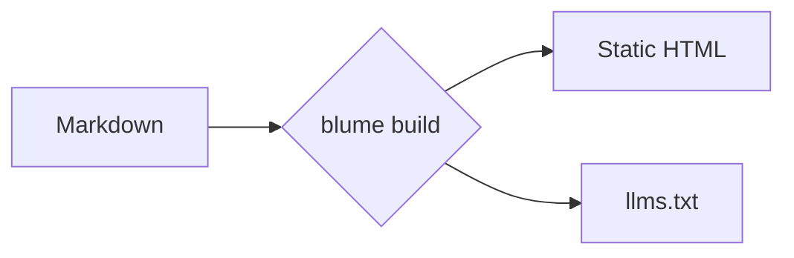
````

डायग्राम क्लाइंट पर रेंडर होते हैं, इसलिए यह केवल-MDX फ़ीचर है, और Pele केवल उन्हीं पेजों पर लोड होता है जिनमें कोई डायग्राम हो; जिस साइट में कोई डायग्राम नहीं है, वह इसे बिल्कुल भी शिप नहीं करती। Pele डायग्राम को अपने इंजन से लेआउट करता है, इसलिए Mermaid के `layout` और `look` विकल्प तथा उसके थीम रंग लागू नहीं होते; `style`, `classDef` या किसी सीक्वेंस `rect` से सेट किए गए रंग दोनों थीम में स्थिर रहते हैं, जबकि बाकी सब कुछ साइट टोकन का अनुसरण करता है। एक डायग्राम सामग्री कॉलम की चौड़ाई के अनुसार फिर से लेआउट होता है — चौड़ा फ़्लोचार्ट ऊर्ध्वाधर लेआउट में बदल सकता है — हमेशा फ़िट होने के लिए सिकुड़ने के बजाय, और लेबल थीम फ़ॉन्ट का उपयोग करते हैं। जिस डायग्राम को Pele पार्स नहीं कर पाता, उसकी जगह "Could not render this diagram." दिखता है; पार्सर त्रुटि, उस लाइन सहित जहाँ वह रुका, ब्राउज़र कंसोल में जाती है, और `blume dev` भी उसे संदेश के नीचे प्रिंट करता है। इस अनुभाग का बाकी हिस्सा सामान्य प्रकारों की एक गैलरी है — पूरी सूची के लिए [Mermaid डॉक्स](https://mermaid.js.org/intro/) देखें।

### फ़्लोचार्ट [#flowchart]


### सीक्वेंस डायग्राम [#sequence-diagram]

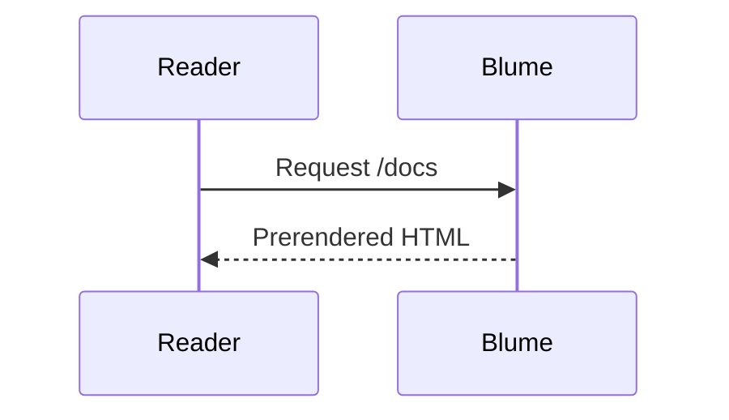

### क्लास डायग्राम [#class-diagram]

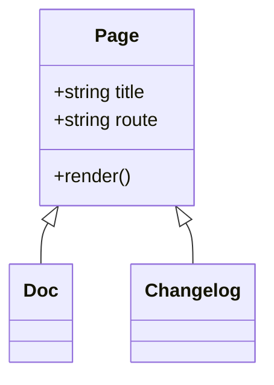

### स्टेट डायग्राम [#state-diagram]

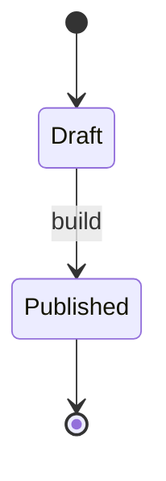

### एंटिटी रिलेशनशिप [#entity-relationship]

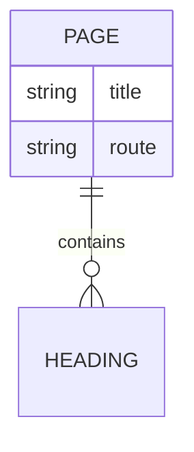

### यूज़र जर्नी [#user-journey]

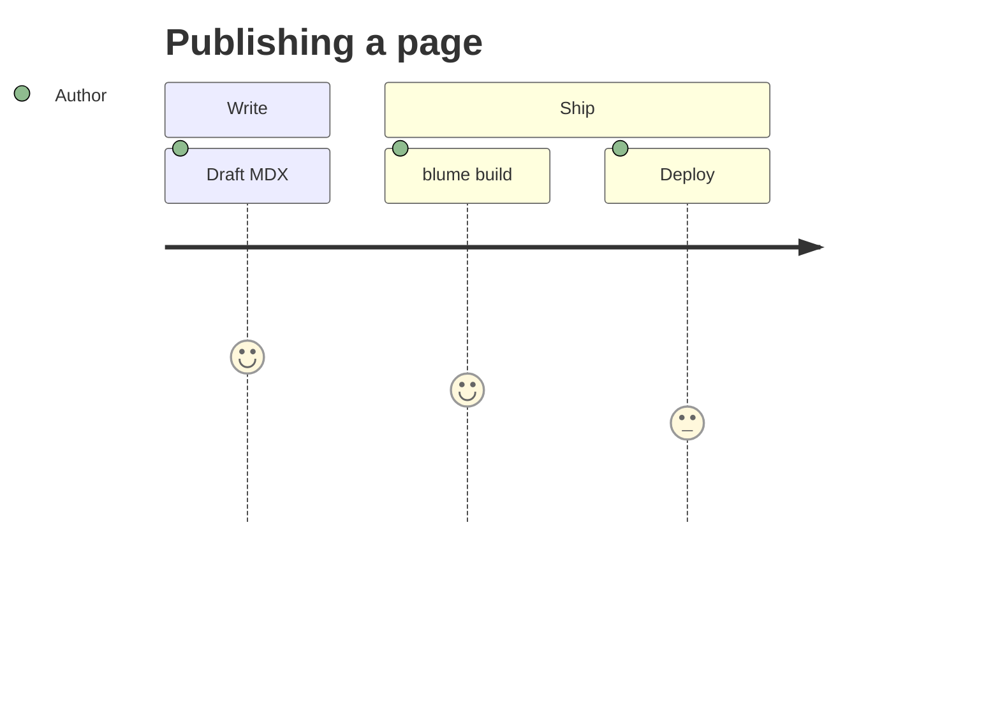

### गैंट [#gantt]

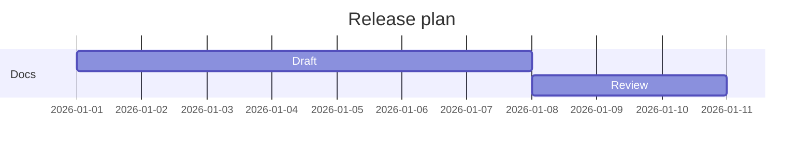

### गिट ग्राफ़ [#git-graph]

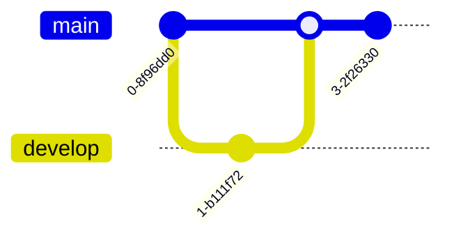

### पाई चार्ट [#pie-chart]

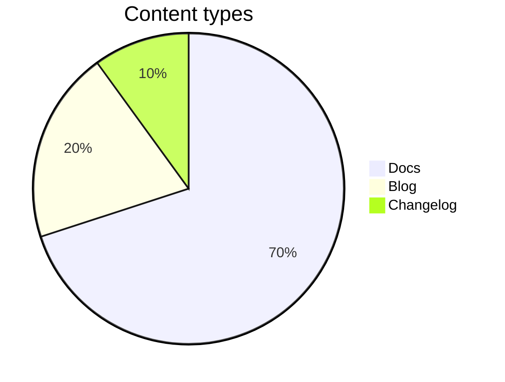

### माइंडमैप [#mindmap]

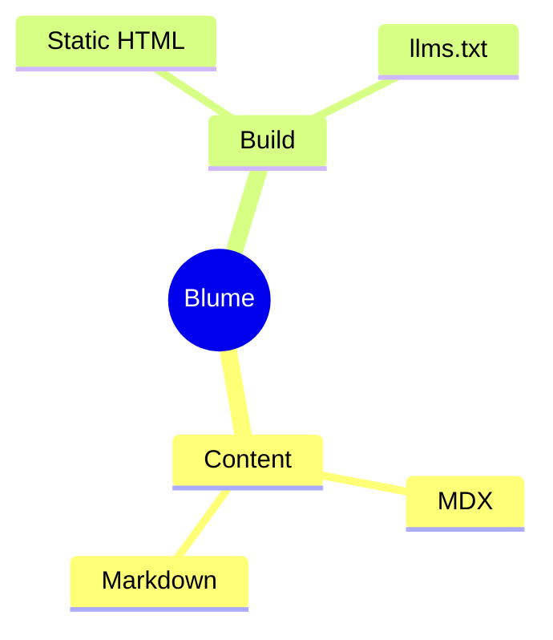

### टाइमलाइन [#timeline]

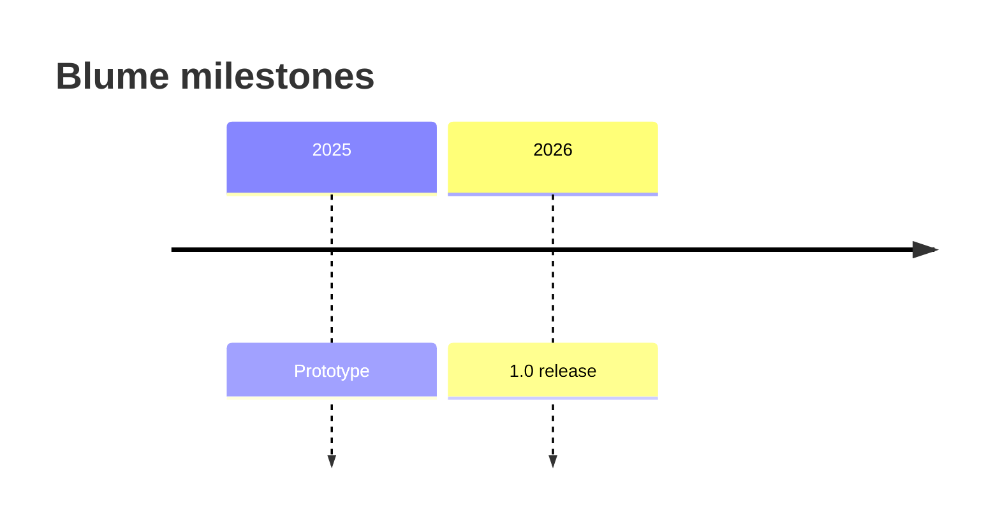

## कॉलआउट [#callouts]

कॉलआउट पाठक का ध्यान संदर्भ, सलाह, या जोखिम की ओर खींचते हैं। उन्हें `:::type` डायरेक्टिव के रूप में लिखें; ब्रैकेट में शीर्षक जोड़ें, जैसे `:::warning[Heads up]`। शीर्षक अपनी इनलाइन फ़ॉर्मेटिंग बनाए रखता है, इसलिए ब्रैकेट में मौजूद कोड, ज़ोर, और लिंक शीर्षक में रेंडर होते हैं। डायरेक्टिव केवल-MDX फ़ीचर हैं — किसी `.md` फ़ाइल में `:::note` लाइन शाब्दिक पाठ ही रहती है, और `blume dev`, `blume build`, और `blume check` उसके बारे में `BLUME_MD_DIRECTIVE` के रूप में चेतावनी देते हैं। उसे कॉलआउट के रूप में रेंडर करने के लिए पेज का नाम बदलकर `.mdx` करें।

### नोट [#note]

तटस्थ, सहायक संदर्भ जिसे पाठक को ध्यान में रखना चाहिए।

:::note
Blume हर रन पर `.blume/` को फिर से बनाता है — इसे कभी हाथ से संपादित न करें।
:::

```md
:::note
Blume regenerates `.blume/` on every run — never edit it by hand.
:::
```

### टिप [#tip]

एक उपयोगी शॉर्टकट या सर्वोत्तम अभ्यास जो अनिवार्य नहीं है पर जीवन आसान बना देता है।

:::tip
`deployment.site` सेट करें ताकि साइटमैप और Open Graph इमेज निरपेक्ष URL का उपयोग करें।
:::

```md
:::tip
Set `deployment.site` so sitemaps and Open Graph images use absolute URLs.
:::
```

### सफलता [#success]

किसी सकारात्मक परिणाम की पुष्टि करें या यह कि कोई चरण अपेक्षा के अनुसार पूरा हुआ।

:::success
आपके डॉक्स सफलतापूर्वक बन गए और डिप्लॉय के लिए तैयार हैं।
:::

```md
:::success
Your docs built successfully and are ready to deploy.
:::
```

### चेतावनी [#warning]

ऐसी किसी बात को चिह्नित करें जिसमें गलती या अप्रत्याशित व्यवहार से बचने के लिए सावधानी चाहिए।

:::warning[ध्यान दें]
सर्वर आउटपुट को डिप्लॉय करने से पहले `blume/deploy` से एक होस्ट एडाप्टर चाहिए।
:::

```md
:::warning[Heads up]
Server output needs a host adapter from `blume/deploy` before you can deploy.
:::
```

### ख़तरा [#danger]

ऐसी विध्वंसक या भंजक कार्रवाई को उजागर करें जिसे आसानी से पलटा नहीं जा सकता।

:::danger
`blume eject` एकतरफ़ा कदम है — उत्पन्न Astro प्रोजेक्ट आपका हो जाता है।
:::

```md
:::danger
`blume eject` is a one-way step — the generated Astro project becomes yours.
:::
```

### जानकारी [#info]

एक सूचनात्मक टिप्पणी; एक उपनाम-अनुकूल डिफ़ॉल्ट जो तटस्थ लगता है।

:::info
कोर थीम कोई क्लाइंट फ़्रेमवर्क JS शिप नहीं करती।
:::

```md
:::info
The core theme ships no client framework JS.
:::
```

`caution`, `error`, `important`, और `warn` नाम क्रमशः `warning`, `danger`, `note`, और `warning` के उपनाम के रूप में स्वीकार किए जाते हैं।

कोई भी अन्य नाम कॉलआउट नहीं होता। उसका कंटेंट फिर भी रेंडर होता है — उसकी `:::` लाइनों के बीच, जो पेज पर ज्यों की त्यों बनी रहती हैं — इसलिए किसी अन्य डॉक्स टूल से लाया गया `:::details`, या `:::warnig` जैसी टाइपो, उसके भीतर की सामग्री को कभी नहीं छिपाती। `blume dev`, `blume build`, और `blume check` इसके बारे में `BLUME_UNKNOWN_DIRECTIVE` के रूप में चेतावनी देते हैं, और ऊपर दिए गए कॉलआउट प्रकारों के नाम बताते हैं।

किसी कॉलआउट को दूसरे कॉलआउट के भीतर रखने के लिए, बाहरी कॉलआउट को एक लंबी फ़ेंस दें:

```md
::::note
Blume regenerates `.blume/` on every run.

:::tip
Commit `blume.config.ts`, not `.blume/`.
:::
::::
```

नाम को कोलन के ठीक बाद लिखें। स्पेस वाला `::: tip` (वह वर्तनी जिसका उपयोग VitePress, VuePress, और Docusaurus v2 करते हैं) डायरेक्टिव नहीं होता, इसलिए पेज उस लाइन को पाठ के रूप में दिखाता है, और इस तरह लिखे गए कॉलआउट नाम के बारे में Blume `BLUME_DIRECTIVE_SPACED_NAME` के रूप में चेतावनी देता है। शीर्षक ब्रैकेट में लिखा जाता है: नाम के बाद का पाठ, जैसे `:::tip Some title` में, कॉलआउट तो खोलता है पर कभी दिखता नहीं, और Blume उसके बारे में `BLUME_DIRECTIVE_OPENING_TEXT` के रूप में चेतावनी देता है, साथ ही ब्रैकेट वाली वर्तनी `:::tip[Some title]` भी बताता है। किसी कंटेनर के भीतर, ऐसी समापन फ़ेंस जिसके कोलन के बाद पाठ हो, फिर भी उसे बंद कर देती है, और वह पाठ हटा दिया जाता है: किसी `:::warning` के भीतर `::: card` लाइन कॉलआउट को वहीं समाप्त कर देती है, और `card` कभी नहीं दिखता। Blume उस लाइन के बारे में `BLUME_DIRECTIVE_CLOSING_TEXT` के रूप में चेतावनी देता है। उसे कॉलआउट के भीतर पाठ के रूप में बनाए रखने के लिए, ऊपर की तरह कॉलआउट को एक लंबी फ़ेंस दें, या कोलन के बाद का पाठ हटा दें।

### GitHub अलर्ट [#github-alerts]

GitHub का अलर्ट सिंटैक्स भी कॉलआउट के रूप में रेंडर होता है: ऐसा ब्लॉककोट जिसकी पहली लाइन `[!NOTE]`, `[!TIP]`, `[!IMPORTANT]`, `[!WARNING]`, या `[!CAUTION]` हो, किसी भी केस में। उस लाइन पर मार्कर के बाद का पाठ शीर्षक बन जाता है।

{/* prettier-ignore */}
> [!TIP]
> `deployment.site` सेट करें ताकि साइटमैप और Open Graph इमेज निरपेक्ष URL का उपयोग करें।

{/* prettier-ignore */}
```md
> [!TIP]
> Set `deployment.site` so sitemaps and Open Graph images use absolute URLs.
```

`[!NOTE]` और `[!TIP]` उसी नाम के कॉलआउट के रूप में रेंडर होते हैं, `[!IMPORTANT]` नोट के रूप में, `[!WARNING]` चेतावनी के रूप में, और `[!CAUTION]` ख़तरा कॉलआउट के रूप में, जो GitHub के लाल रंग से मेल खाता है। GitHub की तरह ही, किसी दूसरे ब्लॉककोट के भीतर उद्धृत अलर्ट ब्लॉककोट ही रहता है, और कोई भी अन्य मार्कर, जैसे `[!INFO]`, भी ब्लॉककोट ही रहता है।

लाइनों को जोड़ने वाला फ़ॉर्मैटर, जैसे `proseWrap: "never"` के साथ oxfmt, मुख्य भाग की पहली लाइन को ऊपर खींचकर मार्कर के बगल में ले आता है, जहाँ वह शीर्षक बन जाती है (यह इसी तरह [डायरेक्टिव को भी समेट देता है](/docs/faq#why-is-oxfmt--ultracite-collapsing-my-directives))। उन्हें अलग रखने के लिए मार्कर के बाद एक `>` लाइन खाली छोड़ें; GitHub इस रूप को भी रेंडर करता है।

डायरेक्टिव की तरह, अलर्ट भी केवल-MDX हैं। किसी `.md` फ़ाइल में ब्लॉककोट ब्लॉककोट ही रहता है और अपना मार्कर पाठ के रूप में दिखाता है, और `blume dev`, `blume build`, और `blume check` उसके बारे में `BLUME_MD_GITHUB_ALERT` के रूप में चेतावनी देते हैं। उसे कॉलआउट के रूप में रेंडर करने के लिए पेज का नाम बदलकर `.mdx` करें।

## गणित [#math]

KaTeX के साथ LaTeX रेंडर करें, जो गणित-प्रधान या वैज्ञानिक डॉक्स के लिए उपयोगी है। केंद्रित ब्लॉक के लिए `$$…$$` को अलग-अलग लाइनों पर रखें:

$$
\int_0^\infty e^{-x^2}\,dx = \frac{\sqrt{\pi}}{2}
$$

```md
$$
a^2 + b^2 = c^2
$$
```

या इनलाइन गणित के लिए किसी वाक्य के भीतर `$$…$$` लिखें, जैसे ऑयलर की सर्वसमिका $$e^{i\pi} + 1 = 0$$:

```md
Like Euler's identity $$e^{i\pi} + 1 = 0$$.
```

:::note
गणित स्वतः चालू है: `$$…$$` लिखें और यह रेंडर हो जाता है; न लिखें तो KaTeX की स्टाइलशीट कभी शिप नहीं होती। ब्लॉक और इनलाइन, दोनों तरह का गणित दो डॉलर चिह्नों का उपयोग करता है। अकेला `$` (मुद्रा, शेल वेरिएबल, कोड) हमेशा शाब्दिक पाठ ही रहता है, इसलिए "$5 और $10" कभी गणित में नहीं बदलता, और न कोई डीलिमिटर एस्केप करना है और न कोई सेटिंग टॉगल करनी है। गणित एक केवल-MDX फ़ीचर है। रेंडर किए गए मार्कअप के भीतर के क्लास नाम (`.katex-html`, `.katex-base`, …) KaTeX के अपने आंतरिक विवरण हैं, कोई ऐसा स्टाइलिंग अनुबंध नहीं जिसे Blume बनाए रखता हो — KaTeX के अपग्रेड होने पर वे बदल सकते हैं, इसलिए कस्टम स्टाइल के लिए `.katex-display` रैपर को लक्षित करें।
:::

## स्मार्ट विराम-चिह्न [#smart-punctuation]

Blume लिखते समय सीधे उद्धरण चिह्नों और डैश को टाइपोग्राफिक समकक्षों में बदल देता है, ताकि गद्य ऐसा पढ़ा जाए जैसे उसे टाइपसेट किया गया हो — किसी विशेष वर्ण की ज़रूरत नहीं।

"उद्धरण" घुमावदार हो जाते हैं, -- एन डैश बन जाता है, --- एम डैश, और ... एक दीर्घवृत्त।

```md
"Quotes" become curly, -- becomes an en dash, --- an em dash, and ... an ellipsis.
```

## अन्य टूल का सिंटैक्स [#syntax-from-other-tools]

Blume केवल इस पेज पर दिया गया सिंटैक्स पढ़ता है, और कुछ नहीं। जो सिंटैक्स कोई अन्य डॉक्स टूल पढ़ता है, वह पेज पर ज्यों का त्यों दिखता है, या रेंडर होते समय किसी `.mdx` पेज को तोड़ देता है, इसलिए `blume dev`, `blume build`, और `blume check` उसकी लाइन पर उसके बारे में चेतावनी देते हैं। कोड ब्लॉक, इनलाइन कोड, और टिप्पणियाँ छोड़ दी जाती हैं, इसलिए किसी उदाहरण को पाठ के रूप में दिखाने के लिए उसे इनलाइन कोड में लपेटें।

- `BLUME_TEMPLATE_TAG`: किसी `.md` पेज में कोई Liquid या Markdoc टैग (``, ``) या कोई Liquid आउटपुट (`{{ site.title }}`)। Blume कोई टेम्पलेट भाषा नहीं चलाता, इसलिए टैग की जगह वह लिखें जो वह उत्पन्न करता था, और साइट-व्यापी मान की जगह कोई [वेरिएबल](/docs/content/variables)। ऐसा `{{name}}` जो वेरिएबल हो सकता है, यहाँ रिपोर्ट नहीं किया जाता।
- `BLUME_WIKILINK_UNSUPPORTED`: कोई विकि लिंक (`[[Home]]`, `[[Text|Page]]`) जो साइट के किसी पेज का नाम उसकी फ़ाइल के नाम या शीर्षक से लेता है, या `|` वाला कोई भी विकि लिंक। केवल [Obsidian वॉल्ट](/docs/content/sources/obsidian) सोर्स ही विकि लिंक पढ़ता है। चेतावनी वह Markdown लिंक बताती है जो उसकी जगह लेगा।
- `BLUME_MDC_SYNTAX`: कोई Nuxt Content (MDC) ब्लॉक कंपोनेंट (`::callout` … `::`) या इनलाइन कंपोनेंट (`:badge[New]{color="primary"}`)। इसके बजाय संबंधित [कंपोनेंट](/docs/content/components) या कोई `:::` कॉलआउट उपयोग करें।
- `BLUME_MDX_ATTRIBUTE_LIST`: किसी `.mdx` पेज में कोई एट्रिब्यूट सूची (`{ width="300" }`, `{: .note }`)। MDX ब्रेसेस को JavaScript के रूप में पढ़ता है, इसलिए पेज बिल्ड होने में विफल हो जाता है। इसके बजाय एट्रिब्यूट किसी JSX एलिमेंट पर सेट करें (``), और किसी शीर्षक की एंकर `[#id]` से स्थिर करें।
- `BLUME_MD_ATTRIBUTE_LIST`: किसी `.md` पेज में कोई एट्रिब्यूट सूची, जैसे अपनी अलग लाइन पर या किसी ब्लॉक के बाद kramdown का `{: .note }` या `{: #intro }`, या किसी इमेज के बाद `{ width="300" }`। पेज इसे ज्यों का त्यों दिखाता है। इसके बजाय एट्रिब्यूट किसी HTML एलिमेंट पर सेट करें (``), और किसी शीर्षक की एंकर `[#id]` से स्थिर करें। किसी शीर्षक के `{#id}` मार्कर को इसके बजाय [`BLUME_MD_CURLY_ANCHOR`](#custom-anchors) कवर करता है।
- `BLUME_MDX_UNCLOSED_ELEMENT`: किसी `.mdx` पेज में, या ऐसे पार्शियल में जिसे कोई `.mdx` पेज [इनक्लूड](/docs/content/includes) करता है, समापन स्लैश के बिना कोई HTML void एलिमेंट (``, `<br>`)। MDX इसे एक बंद न किया गया JSX एलिमेंट मानता है, इसलिए इसे बंद करें: `<br />`।
